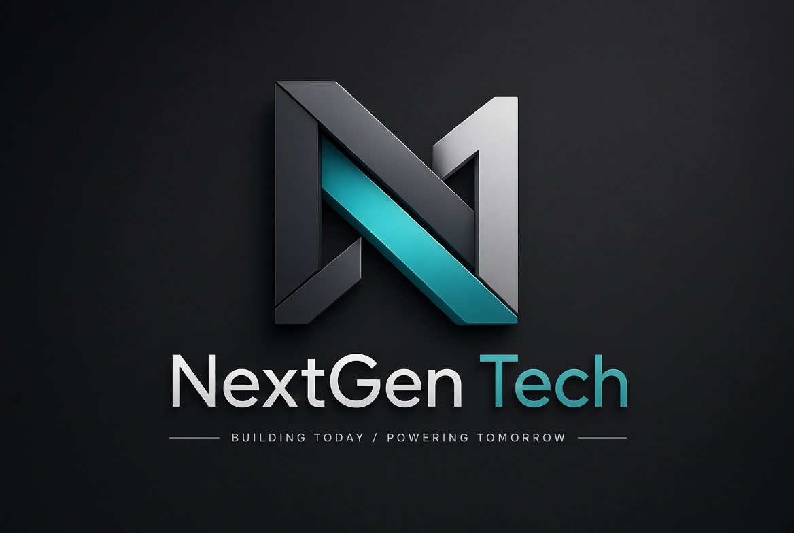

<div align="center">

  

  # NextGen Technologies

  <p align="center">
    <strong>BUILDING TODAY / POWERING TOMORROW</strong><br>
    <em>One company. Multiple technologies. One interconnected digital ecosystem.</em>
  </p>

  <p align="center">
    <a href="https://github.com/NextGenTechAfrica/NextGenTechAfrica"></a>
    <a href="https://react.dev/"></a>
    <a href="https://www.typescriptlang.org/"></a>
    <a href="https://vitejs.dev/"></a>
    <a href="https://tailwindcss.com/"></a>
    <a href="https://threejs.org/"></a>
  </p>

  <p align="center">
    <a href="#-the-ecosystem">Ecosystem</a> •
    <a href="#-pages--routes">Pages</a> •
    <a href="#-interactive-features">Features</a> •
    <a href="#-tech-stack">Tech Stack</a> •
    <a href="#-project-structure">Directory Structure</a> •
    <a href="#-getting-started">Getting Started</a> •
    <a href="#-configuration">Configuration</a>
  </p>

</div>

---

## 🌍 About NextGen Technologies

**NextGen Technologies** is a digital venture builder and technology holding company founded to solve critical infrastructure, trust, and software engineering challenges across Africa and global markets.

Rather than building isolated applications, NextGen operates as a unified venture engine: engineering, incubating, launching, and scaling specialized digital platforms under one synergistic umbrella.

---

## 🏛️ The Ecosystem

NextGen Technologies powers a growing constellation of specialized digital platforms:

| Platform | Category | Stage | Description & Links |
|---|---|---|---|
| 🌐 **[CodeBridge](https://code-bridge-rosy.vercel.app)** | Enterprise Software & Engineering | `LIVE` | Dedicated full-stack software development, custom Business Management Systems (BMS), and milestone-based escrow delivery.<br>🔗 [Live App](https://code-bridge-rosy.vercel.app) • [GitHub](https://github.com/NextGenTechAfrica/CodeBridge) |
| 🛡️ **[MarketBridge](https://market-bridge-llc.vercel.app)** | Commerce & Trustless Marketplaces | `LIVE` | The trustless multi-vendor marketplace featuring verified dealer onboarding (CAC/NIN), automated Flutterwave escrow protection, and visual delivery audits.<br>🔗 [Live App](https://market-bridge-llc.vercel.app) • [GitHub](https://github.com/NextGenTechAfrica/MarketBridgeLLC) |
| ⚡ **NextGen Core** | Infrastructure & Shared Services | `IN DEVELOPMENT` | Foundational substrate providing cross-platform Single Sign-On (SSO), shared escrow primitives, telemetry, and unified design tokens across all ventures.<br>🔗 [Organization](https://github.com/NextGenTechAfrica) |

---

## 🌟 Key Interactive & Visual Features

- **🌐 Interactive 3D Spinning Earth**: Realistic Earth rendering with atmospheric glow, dynamic cloud layers, and auto-rotation powered by Three.js (`SpinningEarthCanvas.tsx`).
- **🌌 Constellation & Space Canvas**: Smooth ambient particle fields that respond fluidly to cursor attraction and touch inputs (`AnimatedSpaceBackground.tsx`, `HeroBackgroundCanvas.tsx`).
- **🌗 Complete Dual Theme Engine**: Flawless dark mode (deep charcoal `#07090b` and electric cyan `#00c4d4`) and crisp light mode with localStorage persistence and OS preference detection (`ThemeContext.tsx`, `ThemeToggle.tsx`).
- **✨ Framer Motion Micro-Interactions**: Silky smooth scroll reveals, cascading stagger lists, and interactive hover cards designed to elevate the user experience (`ScrollReveal.tsx`).
- **📱 100% Responsive & Accessible**: Crafted with semantic HTML5, keyboard navigation, high-contrast ratios, and full respect for `prefers-reduced-motion`.
- **🧩 Reusable Data-Driven Platform Showcase**: Dedicated portfolio engine rendering real-time problem comparisons, feature sets, development milestones, and status tags from structured data (`platformsData.ts`).

---

## 🗺️ Pages & Routes

| Route | Page | Purpose |
|---|---|---|
| `/` | **Home** | Brand narrative, 3D interactive Earth, interactive Constellation canvas, "The Idea" manifesto, ecosystem preview, platform cards, and call to action. |
| `/about` | **About** | Origin story, the venture studio model, organizational philosophy, and our candid "Still Building" transparency commitment. |
| `/ecosystem` | **Ecosystem** | Architectural breakdown across Enterprise Software, Trustless Marketplaces, Applied AI, and Core Infrastructure. |
| `/platforms` | **Platforms Portfolio** | Complete venture catalog with category filtering and stage tags (`LIVE`, `IN DEVELOPMENT`, `COMING SOON`, `CONCEPT`). |
| `/platforms/:id` | **Platform Detail** | Dynamic platform overview (e.g., `/platforms/codebridge`, `/platforms/marketbridge`) highlighting challenges solved, key capabilities, milestones, and external deployment links. |
| `/vision` | **Vision & Principles** | Mission, long-term roadmap philosophy, and the 4 foundational pillars: *Build with Purpose*, *Keep Learning*, *Think Long Term*, and *People First*. |
| `/roadmap` | **Roadmap** | Directional milestone tracker categorized into `NOW`, `NEXT`, `LATER`, and `BEYOND`. |
| `/contact` | **Contact** | Inquiry form with topic selectors, quick email copy button, and WhatsApp integration. |

---

## 🛠️ Tech Stack

- **Core**: [React 18.3](https://react.dev/) + [TypeScript 5.7](https://www.typescriptlang.org/)
- **Build Tool**: [Vite 6](https://vitejs.dev/)
- **Routing**: [React Router DOM v6](https://reactrouter.com/)
- **Styling**: [Tailwind CSS 3.4](https://tailwindcss.com/) + Custom HSL Tokens & Glassmorphism
- **3D Graphics & Canvas**: [Three.js 0.186](https://threejs.org/) + Native HTML5 Canvas 2D
- **Animations**: [Framer Motion 13](https://www.framer.com/motion/)
- **Icons**: [Lucide React](https://lucide.dev/) + Custom High-Contrast SVG Brand Assets

---

## 📂 Project Structure

```
nextgentechafrica/
├── public/
│   ├── earth-map.jpg                # High-res Three.js Earth surface texture
│   ├── hero-earth.jpg               # Atmospheric Earth background asset
│   ├── nextgen-logo.png             # Official NextGen Technologies logo
│   ├── nextgen-lockup.png           # Extended horizontal brand lockup
│   ├── nextgen-emblem.png           # Icon-only circular emblem
│   └── mockup.png                   # Device preview assets
├── src/
│   ├── components/
│   │   ├── common/
│   │   │   ├── Button.tsx           # Standardized primary/outline buttons
│   │   │   ├── ScrollReveal.tsx     # Framer motion fade and stagger reveal wrapper
│   │   │   ├── SectionHeading.tsx   # Consistent headers and section pills
│   │   │   ├── SocialIcons.tsx      # SVG icons for GitHub, LinkedIn, Instagram, X
│   │   │   ├── StatusBadge.tsx      # Color-coded lifecycle status tags
│   │   │   └── ThemeToggle.tsx      # Sun/Moon interactive theme switcher
│   │   ├── ecosystem/
│   │   │   └── EcosystemDiagram.tsx # Interactive constellation architecture diagram
│   │   ├── home/
│   │   │   ├── AnimatedSpaceBackground.tsx # Ambient starfield canvas
│   │   │   ├── EcosystemPreview.tsx # Highlights of the venture model
│   │   │   ├── HeroBackgroundCanvas.tsx    # Interactive constellation mesh
│   │   │   ├── HeroSection.tsx      # Hero banner with primary call to actions
│   │   │   ├── PlatformsPreview.tsx # Interactive platform cards
│   │   │   ├── SpinningEarthCanvas.tsx     # Three.js 3D interactive globe
│   │   │   ├── TheIdeaSection.tsx   # Foundational narrative
│   │   │   ├── WhatWeBuildSection.tsx      # Architectural pillars grid
│   │   │   └── WhyNextGenSection.tsx       # Value proposition and differentiators
│   │   ├── layout/
│   │   │   ├── Navbar.tsx           # Sticky responsive navigation with mobile drawer
│   │   │   └── Footer.tsx           # Comprehensive footer with back-to-top button
│   │   └── platforms/
│   │       └── PlatformCard.tsx     # Reusable showcase card with tags and links
│   ├── config/
│   │   └── contactConfig.ts         # Central configuration for emails, phone, and social handles
│   ├── context/
│   │   └── ThemeContext.tsx         # Dark / Light theme state and persistent storage
│   ├── data/
│   │   ├── platformsData.ts         # Single source of truth for all digital platforms
│   │   ├── ecosystemData.ts         # Ecosystem categories and structural pillars
│   │   ├── principlesData.ts        # Company principles and vision manifesto
│   │   └── roadmapData.ts           # Phased roadmap milestones
│   ├── pages/
│   │   ├── HomePage.tsx
│   │   ├── AboutPage.tsx
│   │   ├── EcosystemPage.tsx
│   │   ├── PlatformsPage.tsx
│   │   ├── PlatformDetailPage.tsx   # Dynamic platform template
│   │   ├── VisionPage.tsx
│   │   ├── RoadmapPage.tsx
│   │   ├── ContactPage.tsx
│   │   └── NotFoundPage.tsx
│   ├── types/
│   │   └── index.ts                 # Central TypeScript interfaces and type definitions
│   ├── App.tsx                      # Root component, router tree, and scroll-to-top hook
│   ├── index.css                    # Tailwind directives, animations, and custom scrollbars
│   └── main.tsx                     # React application entry point
├── index.html                       # HTML head metadata, fonts, and OpenGraph tags
├── tailwind.config.js               # Theme configuration and custom colors
├── tsconfig.json                    # TypeScript configuration
└── vite.config.ts                   # Vite bundler plugins and settings
```

---

## 🚀 Getting Started

### Prerequisites
- [Node.js](https://nodejs.org/) (version `18.x` or higher recommended)
- `npm` or `yarn` / `pnpm`

### 1. Clone the Repository
```bash
git clone https://github.com/NextGenTechAfrica/NextGenTechAfrica.git
cd NextGenTechAfrica
```

### 2. Install Dependencies
```bash
npm install
```

### 3. Run Development Server
```bash
npm run dev
```
Open your browser at `http://localhost:5173` to view the application with hot module replacement (HMR).

### 4. Build for Production
```bash
npm run build
```
Creates an optimized production bundle inside the `dist/` folder.

### 5. Preview Production Build
```bash
npm run preview
```

---

## ⚙️ Configuration & Customization

### Updating Contact Information
Configure your emails, WhatsApp link, and social profiles centrally in [`src/config/contactConfig.ts`](src/config/contactConfig.ts):

```typescript
export const contactConfig: ContactConfig = {
  email: 'contact@nextgentechnologies.org',
  supportEmail: 'support@nextgentechnologies.org',
  whatsappNumber: 'YOUR_WHATSAPP_NUMBER', // E.g., '2348012345678'
  whatsappDisplay: '+234 80 1234 5678',
  linkedinUrl: 'https://linkedin.com/company/nextgen-technologies',
  instagramUrl: 'https://instagram.com/nextgentech',
  githubUrl: 'https://github.com/NextGenTechAfrica',
  twitterUrl: 'https://x.com/nextgentech',
  address: 'Digital Venture Builder — Active Globally & Across Africa'
};
```

### Adding a New Platform to the Ecosystem
To add a new platform or venture, append a new object to [`src/data/platformsData.ts`](src/data/platformsData.ts):

```typescript
{
  id: 'new-venture',
  name: 'New Venture',
  tagline: 'Short descriptive tagline',
  category: 'Enterprise Software & Digital Products',
  status: 'IN DEVELOPMENT', // 'LIVE' | 'IN DEVELOPMENT' | 'COMING SOON' | 'CONCEPT'
  description: 'Detailed description of the venture...',
  problem: 'The specific problem being addressed...',
  idea: 'The innovative solution and architecture...',
  keyFeatures: [
    { title: 'Feature One', description: 'Feature details...', iconName: 'ShieldCheck' }
  ],
  developmentStatus: 'Status update notes...',
  currentMilestone: 'Sprint milestone details...',
  futureDirection: 'Roadmap outlook...',
  tags: ['Web App', 'AI', 'NextGen Venture'],
  externalUrl: 'https://newventure.app',
  githubUrl: 'https://github.com/NextGenTechAfrica/NewVenture'
}
```
> **Note**: The platform will automatically appear on the home preview, the `/platforms` catalog with search and category filters, and gain an automatic dedicated detail page at `/platforms/new-venture` without writing any UI code.

---

## 🔒 License

Distributed under the **MIT License**. See `LICENSE` for more information.

---

<div align="center">
  <p><strong>NextGen Technologies</strong></p>
  <p><em>Building Today / Powering Tomorrow</em></p>
  <p>
    <a href="https://github.com/NextGenTechAfrica">GitHub</a> •
    <a href="mailto:contact@nextgentechnologies.org">Email</a>
  </p>
</div>
